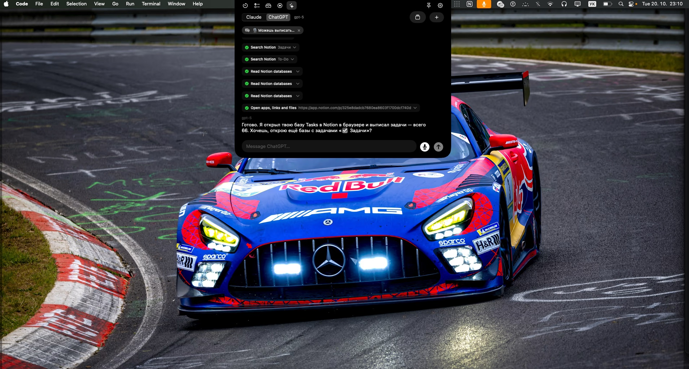
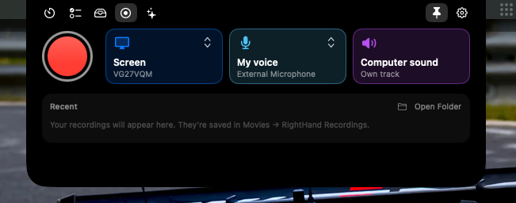
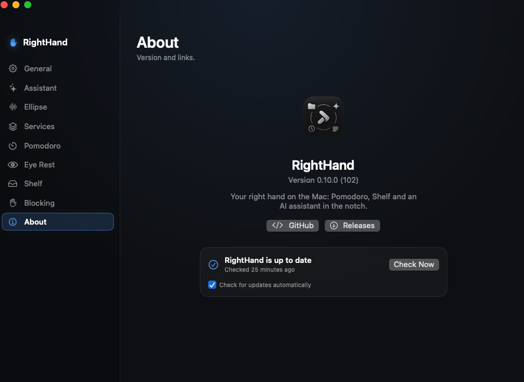

# RightHand

Personal macOS productivity hub that lives in the camera notch. Move the mouse to the
notch and a panel drops down with Pomodoro, tasks, a file/screenshot shelf, screen recording
and an AI assistant (Claude, ChatGPT, Gemini or GitHub Copilot) that works with your Mac, Notion, ClickUp, Jira, Google and Outlook — by text or by voice.



## Run

Run `make` to list all commands (`make run`, `make install`, `make release`, …).
They call the scripts below.

```sh
scripts/run.sh            # build (debug) and launch build/RightHand.app
scripts/build-app.sh release
scripts/install.sh        # build (release) and install into /Applications, then launch
```

Requires macOS 14+ and Xcode (or Command Line Tools) with Swift 5.10+.
For editing in VS Code install the **Swift** extension (`swiftlang.swift-vscode`).

## Meeting recordings

The **Record** tab in the notch records a screen with your voice and the computer sound (the
other people in a call) on separate tracks — HEVC, about 3 GB for two hours, up to four hours.
**Analyze** turns a recording into a transcript with Whisper on your Mac (English, Ukrainian,
Czech and Russian, detected per phrase) and asks Claude or ChatGPT for a review: summary,
decisions, tasks, open questions and an assessment of the meeting. Only the text leaves the Mac.



## Ellipse, the voice assistant

Ellipse is RightHand's voice assistant. Say **"Hey Ellipse"** ("Эй, Эллипс") and your request —
it's sent when you pause — or press **⌥Space** (or the 🎙 button in the notch chat, or the menu
bar item), speak in English, Ukrainian, Czech or Russian, and press it again. The notch
glows while Ellipse listens and works, and the answer is read aloud by the Mac's own voice, so you
can keep working in other windows. The conversation stays in the notch chat.

What Ellipse does:

- **Quick answers**: questions and explanations in a sentence or two.
- **Your Mac**: opens apps, links and files; finds, reads, creates, edits, moves and deletes files;
  runs Terminal commands.
- **Tasks** in Notion and ClickUp: what's due or overdue, what to do next, marking tasks done,
  changing status, priority or due date, adding notes.
- **Gmail and Google Drive** (when connected): finds and summarizes emails and documents, creates
  Google Docs, uploads and downloads files.
- **Planning the day** from open tasks, deadlines and priorities.
- **Memory**: remembers what you ask it to keep, and knows what you wrote in *About me*.

How it behaves: it answers in the language you spoke, in one to three short sentences; it does
the task first and then says what it did; with many results it gives the most important two or
three; it asks one short question when the request is unclear. Anything that changes files, tasks
or runs commands asks for your approval in the notch first.

Speech recognition is Apple's (on the Mac for English and Russian, Apple's free service for
Ukrainian and Czech); speech is made offline by macOS. Settings → Assistant → Ellipse.

## Signing

Local builds are signed with a self-made certificate, "RightHand Local Signing", which
`scripts/setup-signing.sh` creates in your login keychain on the first build. Because every
build has the same signature, macOS keeps the app's permissions (Desktop folder, browser
control, Keychain) after rebuilds. CI builds use an ad-hoc signature.

## Releases

Versions come from commit messages since the last release (`v*` tag):
`Breaking:` → major, `Feature:` / `Enhancement:` → minor, `Feet:` / `Fix:` / `HotFix:` → patch.

```sh
scripts/next-version.sh           # show the next version (empty = nothing to release)
scripts/next-version.sh --notes   # preview the release notes
scripts/release.sh                # merge dev into master and push
scripts/package.sh                # build build/RightHand-<version>.zip locally
```

Pushing to `master` runs `.github/workflows/release.yml`, which builds the app, tags `vX.Y.Z`
and publishes a GitHub release with the zip. RightHand checks the latest release at launch and
every six hours, notifies you, and installs it on request (download, re-sign with the local
certificate so permissions stay, replace in Applications, restart). Local builds take the version
this code would be released as, so they aren't offered their own release.



## Languages

The interface is available in English, Ukrainian, Czech and Russian (Settings → General).
Translations are in `scripts/localization/translations.py`; after changing them run
`python3 scripts/localization/generate.py` to update `Support/Localization/*.lproj`.

## Project layout

```
Package.swift                 Swift Package Manager manifest
Support/Info.plist            App bundle metadata (bundle id, no Dock icon)
scripts/                      Build & run scripts (create the .app bundle)
Sources/RightHand/
  App/                        Entry point and AppDelegate (wires everything together)
  Notch/                      Notch window, hover detection, panel UI with tabs
  MenuBar/                    Menu bar icon + menu
  Settings/                   Settings window
  Shared/                     Small reusable helpers and views
  Features/
    Pomodoro/                 Timer logic, settings, view
    Shelf/                    Files, screenshots and clipboard history
    Tasks/                    Notion and ClickUp tasks in the notch
    Calendar/                 Google Calendar day timeline in the notch
    Recorder/                 Screen recording with separate voice and computer-sound tracks
    Meetings/                 Whisper transcripts and AI reviews of recorded meetings
    Integrations/             Notion, ClickUp and Google (Gmail, Drive) for the AI
    Chat/                     AI chat in the notch
    Projects/                 Projects window and the conversation engine
    Tools/                    What the AI can do on the Mac (files, commands, memory)
```

## Roadmap

- [x] App skeleton: notch panel, menu bar item, settings window
- [x] Pomodoro: focus / short / long breaks, notifications, menu bar countdown
- [x] Shelf: drag & drop files, auto-capture screenshots, clipboard history, folders (saved between launches)
- [x] Eye rest: full-screen 20-20-20 break reminders
- [x] Site blocking during Pomodoro focus (Safari, Chrome, Arc, Brave, Edge, Vivaldi)
- [x] AI chat in the notch: Claude + ChatGPT (switchable), uses the same tools as projects, API keys in Keychain
- [x] Projects window: instructions, files, folders, memory, automatic summarizing
- [x] Assistant tools: files anywhere on the Mac (read, write, edit, move, copy, delete to Trash), Terminal commands, opening apps and links
- [x] Action approval: ask before every action, with "always allow" per tool; commands, deletions and anything outside the project folders always ask
- [ ] Assistant tools: screen & clipboard, system control
- [x] Tasks tab: open Notion tasks (yours or unassigned), overdue and high priority first, tick to mark done
- [x] AI tools for Notion, ClickUp, Jira, Gmail and Outlook (read) and Google Drive; ClickUp and Jira tasks in the Tasks tab
- [x] Four AIs: Claude, ChatGPT, Gemini and GitHub Copilot (GitHub Models), all with the same tools; every model your key can use, chosen in Settings or right in the notch
- [x] "About me" profile that every chat starts with
- [x] Voice: a shortcut (⌥Space) to talk to the AI, a glowing notch with live text and the answer, answers read aloud by the Mac's own voices
- [x] Screen recording for meetings: choose a screen, your voice and the computer sound on separate tracks, HEVC ~3 GB per 2 hours, up to 4 hours
- [x] Meeting review from a recording: local Whisper transcript (you and the others separately, English/Ukrainian/Russian/Czech detected per phrase), then a review by Claude or ChatGPT written for the kind of meeting (lecture, team meeting, stand-up, client call, interview…): summary, timeline of its parts, key points, decisions, tasks or homework, open questions, assessment
- [x] Updates: checks GitHub releases, tells you when a new version is out, installs it from the ✋ menu or Settings → About
- [x] Calendar tab: the day as a timeline from Google Calendar (what Notion Calendar shows), next meeting with Join
- [x] Weekly statistics in the Pomodoro tab: focus time and change against last week, sessions and streak, tasks done, meetings
- [x] Sleep reminder: a note before bedtime, then a card in the notch with “15 more minutes” / “Good night” (later bedtime on weekends)
- [ ] Integrations: Apple Reminders, Notes and the macOS Calendar (EventKit), more
- [x] Global hotkey (⌥Space for Ellipse)
- [ ] Launch at login
